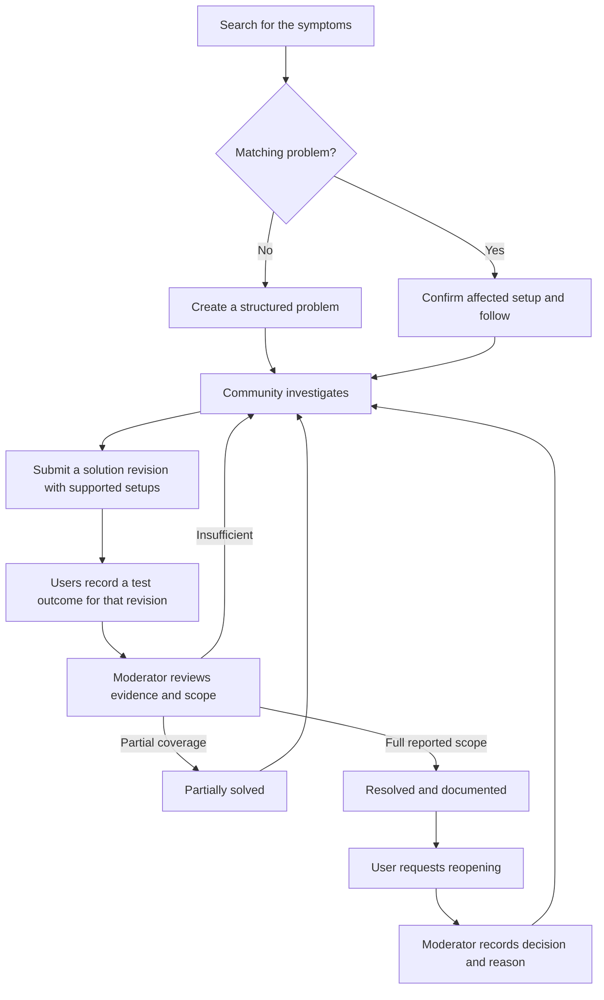
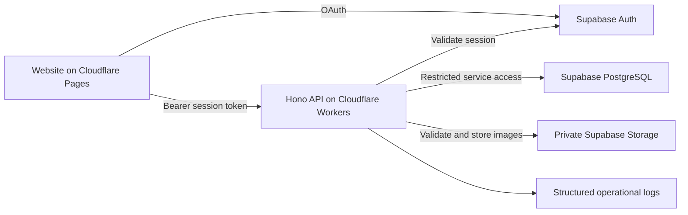

# Product and architecture

## A problem is a permanent record

The duplicate suggestions shown during reporting are advisory. A user may confirm an existing issue or report a distinct one. Only a moderator can perform an explicit duplicate merge.

One account has at most one current affected confirmation, upvote, and follow relationship per problem. Affected confirmations record the setup and count accounts reporting the issue. An upvote expresses priority. Two distinct affected accounts establish community confirmation; they do not prove a diagnosis.

A solution includes reproducible instructions, reasoning, supported setups, limitations, and warnings. Users can record **Worked**, **Did not work**, **Partially worked**, or **Not applicable** once per revision and can edit that result. Success percentages use Worked divided by all applicable tests; Not applicable is excluded. Display the counts and setups so small samples cannot appear conclusive.

Material edits create a new revision with fresh verification. Old evidence remains attached to the revision actually tested. Moderators cannot verify their own solutions. Each verification records evidence, supported scope, and a reason; it does not promise universal success.

Statuses are Reported, Needs information, Confirmed, Investigating, Partially solved, Resolved, Reopened, Duplicate, and Closed. Trending and verified-fix availability are independent indicators. Moderator decisions require a recorded reason. Automatic integrity transitions also record a reason: confirmation withdrawal below two accounts changes Confirmed to Needs information; scope changes or loss of the last current verified fix reopen solved or partially solved records.

## Data boundaries

The browser receives the public Supabase project URL and public publishable/anon key. The service-role key exists only in the backend and the owner's backup environment. The backend validates session identity, account restrictions, permissions, ownership, and input before writes. Application tables deny direct browser access.

The versioned `/api/v1` interface covers accounts, problems, participation, comments, solution revisions, tests, notifications, and moderation. Shared contracts provide validation on both applications. Consult `/api/v1/openapi.json` for the API's exact routes and response shapes.

Database uniqueness constraints prevent duplicate participation under simultaneous requests. Transactional functions preserve evidence during lifecycle changes and duplicate merges. Merging deduplicates participation, retains contributions, and redirects the old problem address to the canonical issue.

Search uses PostgreSQL full-text search and trigram similarity. Trending prioritizes new distinct affected confirmations within seven days, then recent upvotes. Most affected sorts current confirmations. Production statistics come from participation; demonstration records remain confined to local development.

## Images, notifications, and operation

Each contribution accepts at most three JPEG, PNG, or WebP images of at most 500 KB each after browser compression. The API independently checks file type, signature, size, ownership, and contribution limits. Storage bucket `tracker-images` remains private. Files use `ownerId/attachmentUUID.ext`; the API controls attachment reads.

Notifications remain inside the website. No outgoing email delivery service, scheduled paid process, third-party analytics service, or AI processing is required.

The local file-backed demo implementation is a review/development adapter. Production uses Supabase. Development authentication must never be enabled in a public Worker or a publicly reachable local server.
